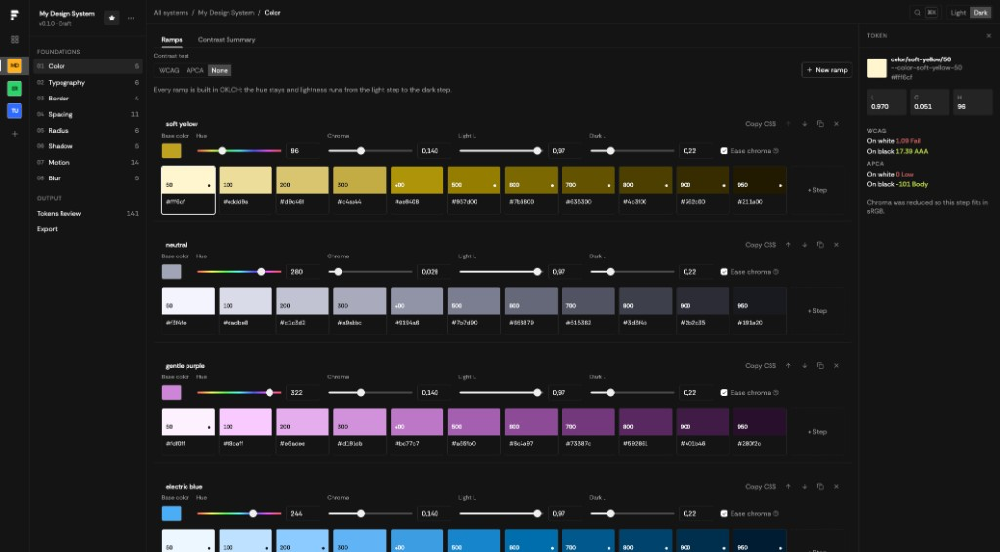
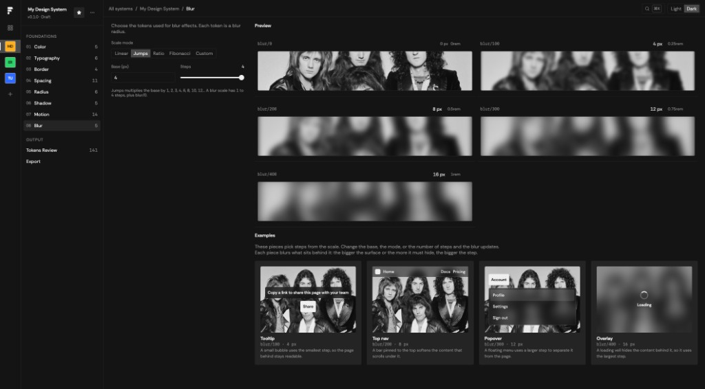

# Foundry

A local tool for building design system foundations and exporting them for design and code.

You define the basics — **color, type, border, spacing, radius, shadow, motion, and blur** — then export to **CSS**, **JSON**, or **Figma**.

Your systems live in this browser on your machine. Figma tokens and file links stay in the browser too and are never written into project files.





## Features

- Multiple design systems in one library, with search and status
- **Live preview** across every foundation — changes show up as you edit
- Editable **scales** with generated steps you can tune as you go
- Accessibility contrast checks for color (**WCAG** and **APCA**)
- **Tokens Review** to inspect the generated variables
- Export to **CSS**, **JSON**, or **Figma** (REST API or local plugin)
- Import a Foundry JSON export to recreate an editable system
- Light/Dark mode

## Foundations

- **Color:** OKLCH ramps with real-time contrast feedback
- **Typography:** Size and line-height scales, families, and sample text
- **Border:** Width scale for UI edges and focus rings
- **Spacing:** Distance scale for layout and spacing tokens
- **Radius:** Corner-radius scale for components
- **Shadow:** Elevation levels with live shadow previews
- **Motion:** Duration, delay, and easing curves
- **Blur:** Backdrop blur scale for overlays and surfaces

## Requirements

- [Node.js](https://nodejs.org/) 20 or newer
- npm

## Run locally

```bash
npm install
npm run dev
```

Then open the URL shown in the terminal (usually `http://localhost:4317`).

### Other commands

```bash
npm run build   # production frontend build
npm start       # run the built app
npm run check   # TypeScript + self-checks
```

## Figma plugin

The `figma-plugin/` folder is a local Figma plugin for importing tokens from Foundry. In Figma: **Plugins → Development → Import plugin from manifest…** and select `figma-plugin/manifest.json`.

1. **Data** — read from a running Foundry instance, or paste JSON
2. **System** — pick the design system
3. **Variables** — choose foundations and create variables in Figma

## License

[MIT](LICENSE) — © 2026 [jcmartinezma](https://github.com/jcmartinezma)
